	

	

- 💻 Platform Manager at **Suridata**, healthtech BI for health insurance brokers and operators
- 🔭 Leading the data platform: extraction, ETL and delivery for ~70 health insurers
- 💬 Ask me about **RAG**, **fine-tuning**, **MCP**, **spec-driven development**, **AI agents**, **BigQuery**, etc.

	
	
	
	
	
	

	
	 
	

	
	
	
	
	
	
	
	
	
	

	
	
	

- **Data Platform API:** FastAPI service with JWT auth for querying BigQuery data by company and period
- **Health ETL pipelines:** bronze/silver pipelines in Python on GCP, deployed with Cloud Build
- **[Control Tower](https://github.com/ErlanLeal/dash-suri-atendimento):** SLA dashboard tracking the whole data delivery operation
- **Quality automation:** replacing manual QA tasks and legacy Qlik flows with automated checks

<b>Leadership · Creativity · Focused · Empathy · Collaborative · Efficient · Calm · Proactive</b>

 

	

